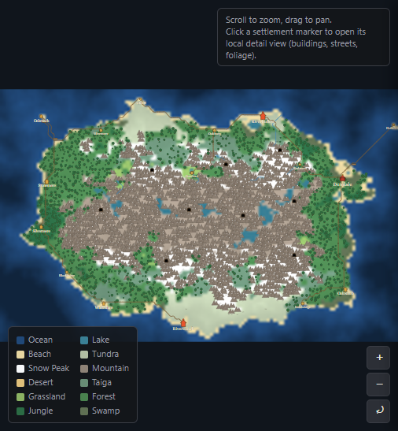
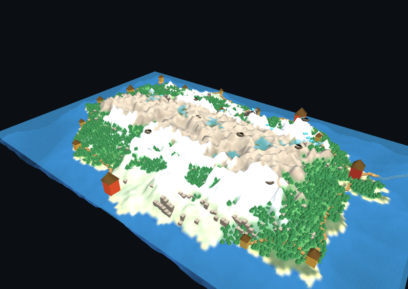

# 🗺️ MapMaker

A layered, procedural **fantasy world map generator** that runs entirely in the browser —
no build step, no server, no dependencies beyond [three.js](https://threejs.org/) (loaded
from a CDN for the optional 3D preview). Open `index.html` and start generating worlds.





## Features

- **Procedural terrain**: seeded height map (island or continent), sea level, and a
  mountain-amount slider that visibly controls how much of the world turns into peaks.
- **Biomes**: ocean, lake, beach, tundra, snow peak, mountain, desert, taiga, grassland,
  forest, jungle, and swamp — derived from elevation, moisture, and temperature.
- **Hydrology**: rivers that flow downhill from mountain sources to the sea, gorges where
  rivers cut through high terrain, and ponds/lakes formed by filling closed depressions.
- **Rock features**: cliffs (slope-edge hachures) and sparse cave POIs.
- **Settlements**: suitability-scored placement (flat, fresh water nearby, comfortable
  climate) with village/town/city/capital tiers, fantasy name generation, and rename support
  (double-click a settlement, or use the ✎ button in its panel).
- **Roads**: a minimum-spanning-tree road network between settlements, with terrain-aware
  pathfinding and bridges wherever a road crosses water.
- **Local village view**: click any settlement to generate its zoomed-in layout — streets
  whose topology matches the settlement's real road/water connections, plots, landmark
  buildings (church/cathedral, market square with stalls & well, keep/castle), stone walls
  with gates, and foliage — all as independently toggleable SVG layers.
- **3D preview**: a simplified WebGL view (via three.js) of the whole world or the
  currently-open village, with orbit/pan/zoom camera controls.
- **Full control via sliders**: world size/detail, sea level, mountains, temperature,
  rainfall, forest density, river count, lakes/ponds, settlement count, and road curviness —
  plus independent layer visibility toggles for both the world and village views.
- **Export**: download the world or village view as a standalone SVG file.

## Getting started

No installation required — just open [`index.html`](index.html) in a modern browser.

```
git clone https://github.com/mykkro/mapmaker.git
cd mapmaker
# then just open index.html in your browser
```

## Project structure

The code is organized into small, single-purpose modules under [`js/`](js), each
responsible for one generation or rendering layer:

```
js/
  core/
    utils.js        seeded RNG, value noise / fBm, small math helpers
  world/
    biomes.js        biome palette + height/moisture/temperature -> biome classification
    terrain.js        height map, sea/lake classification, moisture & temperature fields
    hydrology.js      rivers, cliffs, gorges, ponds/lakes (depression filling)
    settlements.js    fantasy name generator + suitability-scored placement
    roads.js          MST + cost-aware pathfinding + bridge detection
    caves.js          sparse cave POIs on cliff/mountain faces
    worldgen.js       orchestrates the layers above into the final world dataset
    village.js        local/zoomed-in settlement layout generator
  render/
    svg-utils.js      shared SVG helpers + glyph <defs> library
    world-view.js      world map renderer (all layers) + pan/zoom
    village-view.js    local village renderer
  3d/
    viewer3d.js       WebGL 3D preview (world + village), orbit controls
  app.js              UI wiring / application controller
index.html
```

## License

[MIT](LICENSE)
